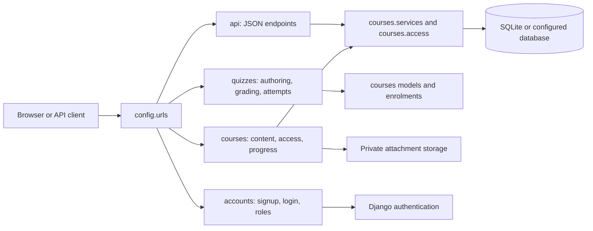
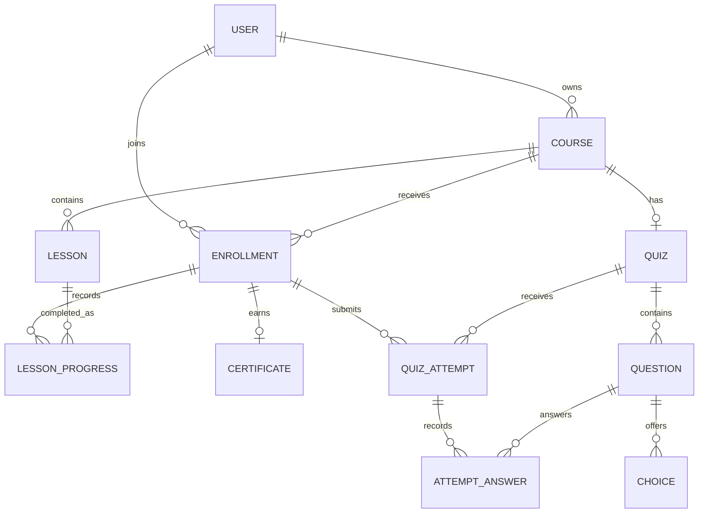

# PUCAR Staff Training LMS — Project Guide

This guide describes the code in this checkout. **Verified** means visible in
the implementation or tests; **inferred rationale** means a reasonable
explanation of why that implementation may have been chosen, not a recorded
statement of the original author's intent. Example names and values below are
illustrative unless explicitly identified as seeded demo data.

## 1. The project in one minute

PUCAR is an internal staff-training learning management system (LMS). In plain
language, it gives instructors a place to publish a course made of ordered
lessons and an end-of-course multiple-choice quiz. Learners can find published
courses, enrol, read lessons, record completion, take quizzes, see progress and
earn a completion certificate. Instructors can manage their own courses and
review learner and question-level results.

The application has both server-rendered web pages and a JSON REST API. The
API reuses the same access and progress services as the pages, but it does not
include course-authoring endpoints. The application is not evidence of a live
deployment; the checked-in deployment files are local/container examples.

## 2. The complete user journey

### Instructor

1. **Sign in or create an account.** `/accounts/login/` uses Django's login
   view. `/accounts/signup/` creates an account but does not sign it in.
   Signup creates a learner by default; an administrator can grant instructor
   role in `/admin/`. Self-selecting instructor is an explicit opt-in setting,
   disabled by default. See `accounts/forms.py`, `accounts/views.py`.
2. **Open the landing page.** `/` routes an instructor to
   `/accounts/dashboard/`; that page links to course analytics at
   `/courses/manage/dashboard/` and course management at `/courses/manage/`.
3. **Create and edit a course.** The instructor selects **New course**.
   `/courses/manage/new/` is handled by `CourseCreateView` and `CourseForm`.
   The logged-in user is assigned as owner by the view; a submitted owner or
   status is not accepted from the form.
4. **Add content and order it.** From the course management page, **Add
   lesson** opens `/courses/manage/<course_id>/lessons/new/`. The
   `LessonForm` stores lesson text and optional video URL/file. The lesson
   position is assigned by the model. Up/Down actions are POST requests and
   reorder through `courses.services`.
5. **Build the quiz.** The course page links to
   `/quizzes/manage/<course_id>/`. `QuizEditorView` edits the course's single
   quiz, its settings, questions and choices on one page. Each question needs
   2–6 choices and exactly one correct choice. Question order is changed with
   separate POST actions.
6. **Preview and publish.** Instructors can preview lessons and a quiz without
   creating learner progress or attempts. Publishing is a POST action from
   the course management page; at least one lesson is required.
7. **Review activity.** `/courses/manage/<course_id>/dashboard/` shows
   enrolments, completion, quiz attempts and question analytics. A
   course-scoped CSV download is available at
   `/courses/manage/<course_id>/dashboard/learners.csv`.

### Learner

1. **Register or sign in.** `/accounts/signup/` and `/accounts/login/` use
   Django forms and authentication. After login, `/` sends a learner to
   `/courses/`.
2. **Find a course.** The catalogue lists published courses and supports title
   or description search, instructor filtering, newest/title sorting and
   pagination (9 cards per page). The query is always filtered to published
   courses.
3. **Open and enrol.** `/courses/<course_id>/` shows the course description and
   lesson outline. A learner enrols with a CSRF-protected POST; the unique
   `(user, course)` constraint makes the operation idempotent.
4. **Study.** A lesson page at
   `/courses/<course_id>/lessons/<lesson_id>/` renders plain text safely,
   optionally links to an external video, and provides an authorized attachment
   download. Marking complete is a POST. If `enforce_order` is enabled, the
   first unfinished lesson is open and later incomplete lessons are locked;
   the server checks both page and POST access, not just whether the link is
   hidden.
5. **Take the quiz and see progress.** An enrolled learner can take the
   published course's quiz at `/quizzes/course/<course_id>/`. Grading happens
   on the server; every submission creates a separate attempt. `/courses/my/`
   shows the learner's enrolments and derived progress.
6. **Get a certificate.** After all lessons are complete and, when a quiz with
   questions exists, a passing attempt is recorded, the learner can POST to
   issue a certificate. The resulting printable page is
   `/courses/<course_id>/certificate/`; its random UUID can be checked without
   logging in at `/certificates/<uuid>/`.

**Unpublishing detail:** it removes the course from the catalogue and blocks
new enrolments. Existing learners can still see the course and lesson pages;
unpublishing does not delete their progress or attempt rows. In this checkout,
however, quiz-taking/result pages explicitly require a published course, and
the attachment view also requires publication for non-owners; those features
are unavailable to learners after unpublishing.

## 3. Where and how an instructor posts course content

The normal content-authoring workflow is the site's instructor UI, not Django
Admin. Admin is available for trusted staff to manage users and records
(attempt and answer records are read-only there), but the course-specific
instructor pages are the direct workflow.

### Course and lesson forms

- Course list: `/courses/manage/` (`InstructorCourseListView`).
- Course create: `/courses/manage/new/` (`CourseCreateView`, `CourseForm`).
- Course detail/manage: `/courses/manage/<course_id>/`
  (`CourseDetailView`).
- Lesson create: `/courses/manage/<course_id>/lessons/new/`
  (`LessonCreateView`, `LessonForm`).
- Lesson edit: `/courses/manage/<course_id>/lessons/<lesson_id>/edit/`.
- Quiz edit: `/quizzes/manage/<course_id>/`.

`CourseForm` accepts **title**, **description**, and **enforce order**. There
is no thumbnail/image field. New courses start as drafts; publication is
managed by a separate toggle, not a field that can be forged in the edit form.
Publishing requires at least one lesson.

`LessonForm` accepts **title**, **content**, **video URL**, and optional
**attachment**. Content is a textarea stored in a database `TextField` as
plain text; it is not a rich-text/HTML or Markdown editor. The lesson page
converts line breaks to paragraphs and Django autoescapes the content. Video
URLs are ordinary `http`/`https` links opened in a new tab; the project does
not embed a video player. There is no dedicated thumbnail or video-upload
feature.

An attachment is uploaded through the lesson form's multipart file field and
stored through Django's filesystem storage under
`media/course_attachments/YYYY/MM/`. The maximum is 10 MiB. The extension
allowlist is `.pdf`, `.doc`, `.docx`, `.ppt`, `.pptx`, `.txt`, `.png`, `.jpg`,
`.jpeg`, and `.zip`. Downloads do not use a public media URL: they go through
`LessonAttachmentView`, which checks access and sends an attachment response
with an allowlisted content type. Validation checks size and filename
extension; it does **not** scan for malware or verify the file's actual
contents.

### Example walkthrough (not pre-created)

To make the example **Python Fundamentals**:

1. Sign in as an instructor, open **Manage my courses**, choose **New course**,
   enter `Python Fundamentals`, add a short description, choose whether to
   enforce lesson order, and save.
2. On that course's management page, choose **Add lesson**. Enter
   `Introduction to Python` as the title and its explanation in the content
   textarea. Optionally enter an HTTPS video link and/or upload an allowed
   attachment. Save.
3. Repeat for `Variables and Data Types` and `Conditional Statements`. They
   receive positions in creation order. Use Up/Down if you want to change that
   order.
4. Choose **Add quiz** or **Edit quiz**. Set the pass mark/attempt limit, then
   enter each question and its 2–6 choices, marking exactly one correct.
   Saving the quiz does not publish the course.
5. Preview the lesson/quiz, then use **Publish** on the course page. Learners
   can now find it in the catalogue, open its details, enrol, and access its
   lessons and quiz.

Course, lesson, enrolment, quiz and result metadata are database records in
SQLite by default. Uploaded attachments are files on disk, and videos remain
external URLs. In Docker, only the SQLite database directory is mounted as a
named volume; the current Compose file does not mount `media/`, so uploaded
files are not preserved by that volume if the container is recreated.

## 4. Technology stack

Versions below are from the local environment checked for this guide.
`requirements.txt` specifies ranges rather than exact pins, so another install
may resolve different compatible versions.

| Technology | Use here | Why it is useful / trade-off | Where |
|---|---|---|---|
| Python 3.12.13 | Application language | Readable backend language; requires a Python runtime | `manage.py`, app modules |
| Django 5.2.18 | Web framework, ORM, authentication, forms, templates and admin | Provides integrated conventions and security features; application remains tied to Django's request/ORM lifecycle | `requirements.txt`, `config/` |
| SQLite | Default relational database | Easy local setup with no server; has less concurrency capability than PostgreSQL | `config/settings.py`, `db.sqlite3` |
| Django REST Framework 3.18.3 | JSON endpoints, serializers, authentication, pagination and throttling | Adds a structured API layer; API authoring is intentionally absent | `api/`, `config/settings.py` |
| drf-spectacular 0.30.0 | OpenAPI schema and Swagger UI | Makes the API contract browsable; it documents implemented API routes, not unimplemented features | `/api/schema/`, `/api/docs/` |
| django-environ 0.14.0 | Read environment variables and optional `.env` | Keeps deployment-specific configuration out of source; `.env` must stay private | `config/settings.py`, `.env.example` |
| Django templates + CSS | Web presentation | Server rendering avoids a separate frontend build; interactivity is ordinary form navigation | `templates/`, `static/css/` |
| WhiteNoise 6.12.0 | Serves collected static assets through Django's WSGI deployment | Avoids a separate static server for this setup; does not solve private media storage | `config/settings.py`, `Dockerfile` |
| Gunicorn 26.2.0 | WSGI application server in Docker | Runs Django behind a production-style HTTP server; it is not a TLS terminator here | `Dockerfile` |
| Ruff 0.17.1 / coverage 7.16.2 | Formatting, linting and test coverage tooling | Gives repeatable code checks; coverage is not the same as production readiness | `ruff.toml`, `.coveragerc`, CI |
| Docker / Compose / GitHub Actions | Container packaging and push-triggered checks | Makes the example environment repeatable; the Compose secret placeholder must be replaced before sharing or deployment | `Dockerfile`, `docker-compose.yml`, `.github/workflows/ci.yml` |
| gettext catalogs | English/Malayalam translations | Lets Django select localized strings; Malayalam text needs fluent-speaker review | `locale/ml/LC_MESSAGES/` |

### Django analogy (helpful but imperfect)

Think of a restaurant: **URLs** are reception directing a request; **views**
are staff coordinating what happens; **forms** check incoming instructions;
**models** describe how information is stored; **templates** are the pages
shown to the visitor. The analogy is imperfect: Django's ORM, request
middleware, templates and views are software components, not literal staff,
and a view may return JSON or a redirect instead of a rendered page.

## 5. Architecture and app map

Typical web request:

```text
Browser
  -> config/urls.py and app urls.py
  -> view checks user/ownership and validates form
  -> shared service applies business rules
  -> Django ORM reads/writes SQLite (and storage handles uploaded files)
  -> template / redirect / streamed download
  -> Browser
```

For the JSON API, the final response is serialized JSON instead of an HTML
template. Web pages and API writes call shared `courses.services` functions
and the shared course visibility helper.



| App / component | Responsibility and dependency |
|---|---|
| `config/` | Settings, root URL routing, WSGI/ASGI. Installs Django and local apps; sets `accounts.User` as the custom user model. |
| `accounts/` | Custom user roles, signup/login, role-aware home, permission mixins and user admin. `OwnerCourseMixin` imports `Course`, so it sits at the boundary between identity and course ownership. |
| `courses/` | Courses, lessons, enrolments, completion, certificates, file validation, learner visibility and shared business services. It also owns the idempotent `seed_demo` command. |
| `quizzes/` | One quiz per course, questions, choices, grading and immutable attempt records. It depends on `courses.Course` and `courses.Enrollment`. |
| `api/` | DRF serializers and JSON views. It uses the course services and access helper rather than maintaining a second set of course rules. |
| `templates/`, `static/`, `locale/` | HTML, CSS, and translation catalogs used by the server-rendered pages. |

## 6. Database and models explained

A **foreign key** stores a link from one database row to another. If a course
has several lessons, each lesson stores the key of its course: this is a
one-to-many relationship (one course, many lessons). A **unique constraint**
lets the database reject duplicate combinations even if two requests race.
`id` values are database identifiers; the certificate also has a random UUID
for public verification.

| Model | What it represents; important fields and relationships |
|---|---|
| `accounts.User` | Staff account extending `AbstractUser`; adds `role` (`instructor` or `learner`). Signup defaults to learner. The application checks role in views rather than enforcing the instructor role as a DB constraint. |
| `courses.Course` | A course; `instructor` FK, `title`, `description`, `status`, `enforce_order`, timestamps. One instructor can own many courses. Deleting an instructor with courses is protected. |
| `courses.Lesson` | One course unit; `course` FK, `title`, plain-text `content`, optional `video_url`, optional `attachment`, `position`. Course deletion cascades to lessons. `(course, position)` is unique; ordered service logic maintains positions. |
| `courses.Enrollment` | One user's participation in one course; FKs to user and course plus `enrolled_at`. `(user, course)` is unique, preventing duplicate enrolments. |
| `courses.LessonProgress` | Completion of one lesson by one enrolment; FKs to enrollment and lesson plus `completed_at`. `(enrollment, lesson)` is unique. Its `clean()` defines a check that the lesson belongs to the enrollment's course. |
| `courses.Certificate` | One issued certificate per enrolment; one-to-one enrollment, random unique UUID `code`, `issued_at`. The printed name/course are read via current related records rather than copied into separate certificate fields. |
| `quizzes.Quiz` | Course quiz settings; one-to-one FK to course, `pass_mark` (default 70), optional `max_attempts` (`NULL` means unlimited), `show_answers`. The one-to-one relationship enforces at most one quiz per course. |
| `quizzes.Question` | A question belonging to a quiz; `text` and ordered `position`. A quiz can have many questions. |
| `quizzes.Choice` | One answer option; FK to question, `text`, `is_correct`. A conditional unique constraint allows at most one correct choice per question; the formset requires exactly one and 2–6 total choices. |
| `quizzes.QuizAttempt` | One submission; FKs to enrollment and quiz, stored `score`, `total`, `percent`, `passed`, and `submitted_at`. Multiple rows preserve multiple attempts. |
| `quizzes.AttemptAnswer` | One answer in an attempt; FK to attempt and question, nullable FK to selected choice. `(attempt, question)` is unique. The question is protected from deletion; deleting a choice sets the historical selection to null. |

**Example (illustrative, not seeded):** learner Maya enrols in Python
Fundamentals. One `Enrollment` row links Maya and that course. Three `Lesson`
rows each point to the course and have positions 1–3. When Maya completes the
first lesson, one `LessonProgress` row links that enrollment to lesson 1.
After submitting the quiz, a `QuizAttempt` stores the outcome and its
`AttemptAnswer` rows store one selected choice per question.

Progress is calculated from completion rows divided by the course's current
lesson count; no percentage is stored. Therefore deleting a lesson also
cascades away its progress rows. Quiz scores/pass status, by contrast, are
stored on each attempt so later pass-mark changes do not recalculate the saved
result.



`LessonProgress.clean()` defines a check that its lesson belongs to the same
course as its enrollment. This is a Django validation hook, not a database
constraint; calling `save()` alone does not automatically run it. The diagram
omits implementation details such as timestamps, constraints and deletion
policies; those are described above and in each app's `models.py`.

## 7. Important engineering decisions and trade-offs

In this table, the implementation column is verified; a rationale marked
**inferred** is explanatory, not a claim about the author's original intent.

| Problem / decision | Implementation and why it makes sense | Trade-off / alternative |
|---|---|---|
| Web framework | **Verified:** Django provides models, forms, built-in auth/admin, templates and URL routing. **Inferred:** an integrated framework suits a small server-rendered LMS without a separate frontend. | Django conventions are framework-specific. A smaller framework might suit a minimal API; a separate SPA could suit richer client interaction. |
| Database | **Verified:** SQLite is the default; quiz submissions account for its lack of row locks by taking a write lock before counting attempts. **Inferred:** avoiding a separate database server makes local setup simpler. | SQLite is simple to run but can encounter write contention and is not a high-concurrency database. PostgreSQL is the documented production direction. The locking path does not add retries for sustained contention. |
| Separate apps and services | **Verified:** accounts, courses, quizzes and API responsibilities are separated; repeated rules live in services/access helpers. | Adds module boundaries and some cross-app imports; a tiny prototype could use fewer modules, while a larger system could split further. |
| Roles and signup | **Verified:** `role` is a user field; instructor self-signup is disabled by default and a crafted role POST is forced to learner. Permissions are checked server-side. | Roles are not DB-level constraints, so admin/operator policy matters. A permission/group system could be preferable if roles become more granular. |
| Publication and visibility | **Verified:** drafts are hidden with 404 from non-owners; publishing requires a lesson; the owner can preview. Enrolled learners retain course/lesson access after unpublish. | Quiz and attachment access currently still require publication. A policy that intends all enrolled learners to retain every asset would need a consistent change to those views and tests. |
| Lesson order | **Verified:** `(course, position)` is unique; service functions renumber/swap inside transactions; page GET, completion POST and attachment download check access. | Move-up/down is simple but not drag-and-drop. More complex curricula might need prerequisites or branching. |
| Quiz history | **Verified:** every submission creates attempt/answer rows in one transaction; grading is server-side and existing result fields are reused. | Old scores persist, but quiz edits do not create a complete question/choice text snapshot; the result review uses current quiz questions. A versioned quiz/snapshot model would give stronger historical fidelity. |
| Progress | **Verified:** completion is a unique row per enrolment/lesson, and percentages are derived. | Counts can change when lessons are added/deleted; stored snapshots would be stable but require synchronization rules. |
| Certificates | **Verified:** eligibility requires all lessons and a pass if a populated quiz exists; a one-to-one row with random UUID is created by POST and publicly verifiable. | The holder/course names come from current related rows, not a frozen printed snapshot. A persisted snapshot may be preferable for legal/long-lived certificates. |
| Validation | **Verified:** Django forms, model constraints, validators and quiz formsets validate inputs; quiz grading checks selected choices against the question. **Inferred:** doing this on the server matters because browser-side checks can be bypassed. | Good validation reduces invalid data but does not replace file scanning, external URL safety policy or operational controls. Client-only checks would be insufficient; a richer API could add dedicated request serializers. |
| REST API | **Verified:** DRF endpoints reuse access/services and expose read-only course data plus learner enrol/complete writes. **Inferred:** this allows scripts/other clients to use learner functions without duplicating rules. | There are no authoring or quiz endpoints. A mobile app needing those would need a deliberately designed API extension. |
| Catalogue and query shape | **Verified:** search, instructor filter, stable sorting and 9-item pagination; SQL annotations and query-count tests avoid per-row queries. | Search is title/description substring matching, not full-text search; a large catalog could warrant database full-text indexing. |
| Tests and CI | **Verified:** Django tests cover models, permissions, edge cases, API and accessibility checks; push CI runs Ruff, migration check and tests with coverage. | Passing tests do not prove production safety, load capacity, UX quality or complete security. More integration/load testing may be useful before launch. |
| Docker | **Verified:** Python 3.12 image, non-root user, Gunicorn, WhiteNoise, SQLite volume and migration entrypoint. | SQLite and local media are not a robust multi-instance deployment design. Use managed database/object storage and deployment-specific secrets for production. |

## 8. Security explained simply

| Protection | What it helps prevent and where it is implemented | Limits / what not to assume |
|---|---|---|
| Login and password rules | Django authentication; `UserCreationForm` plus four configured password validators (`config/settings.py`, `accounts/forms.py`). | Signup does not send email verification or provide a custom password-reset workflow in this project. |
| Role and ownership checks | `InstructorRequiredMixin` returns login redirect for anonymous users and 403 for learners; `OwnerCourseMixin` scopes course lookups to the current instructor. | A role is a field, not a DB permission constraint; keep admin access controlled. |
| Hidden-object responses | Course visibility helper gives 404 for a draft to a non-owner/non-enrollee; attempt and nested course lookups are scoped. | Other flows intentionally use 403 for a published course without enrollment (for example attachment/quiz access). |
| CSRF | Django `CsrfViewMiddleware`; web state-changing forms include `` and use POST, including logout, enrolment, completion, publication, certificates and language switch. | Session-authenticated API POSTs use DRF's session-auth CSRF behavior. Token clients should send the token header and protect the token as a credential. |
| Input validation | ModelForms validate course/lesson fields, quiz formsets enforce choice count/correctness, and service grading verifies each choice belongs to the question. | API has no general-purpose authoring serializer because authoring endpoints are absent; learner POSTs need no editable course fields. |
| Lesson-order enforcement | Shared `can_access_lesson` check is used by the lesson view and completion POST; attachment downloads check it too. API returns 409 for locked lessons. | Order is an application rule, not a database constraint; any future write path must call the shared rule. |
| File handling | `courses/validators.py` enforces 10 MiB and allowed filename extension; the download view checks authorization, ordering and allowlisted response content type; `/media/` is not publicly routed. | No virus scanner or file-signature/content validation is present. Local disk storage and Compose persistence need production work. |
| Output escaping | Django template autoescaping; lesson text is rendered with `linebreaks`; a test verifies a script string is escaped. External video links use `noopener noreferrer`. | This is not a guarantee for arbitrary future uses of `safe` or unsafe JavaScript. |
| API auth and throttling | DRF requires authenticated users by default; session and token auth are enabled; token acquisition is `/api/v1/auth/token/`. Rates are configured at 30/minute anonymous and 120/minute authenticated. | No equivalent custom web-login throttle is configured. API throttle tests verify 429 behavior, but throttling is not a substitute for infrastructure limits. |
| Secret and host configuration | `SECRET_KEY` is required; settings refuse to start if empty. `.env` is gitignored; `.env.example` lists configuration names. `ALLOWED_HOSTS` comes from env. | `docker-compose.yml` currently sets a fixed placeholder key. Replace it before any shared/public deployment; never use committed placeholder values as real secrets. |
| HTTPS and secure cookies | Django `SecurityMiddleware` is installed; Compose sets `DEBUG=False`. | No explicit HTTPS redirect, HSTS, secure session-cookie or secure CSRF-cookie settings appear in `config/settings.py`. TLS and secure production settings must be configured; the local HTTP example is not hardened deployment proof. |
| Quiz record protection | Attempts are application append-only records; attempt/answer admin is read-only; question deletion is refused after it has been answered. | The models do not override `save()` to make every possible programmatic update impossible. Quiz text/choices can change and affect later review rendering even though stored score remains unchanged. |

## 9. REST API explained

The API is mounted under `/api/v1/`. `GET` reads; `POST` performs one of the
supported learner actions. There are no `PUT`, `PATCH` or `DELETE` authoring
operations. Course collection/detail and enrolment lists are read-only.

| Method and route | Purpose / access |
|---|---|
| `POST /api/v1/auth/token/` | Exchange username/password for a DRF token. |
| `GET /api/v1/courses/` | Paginated list of published courses (10 per page). |
| `GET /api/v1/courses/<course_id>/` | Course `id`, `title`, `description`, `instructor`, `status`, `enforce_order`, lesson count/list and timestamps; published, owner preview, or enrolled visibility. Lesson entries contain `id`, `position`, `title`. |
| `POST /api/v1/courses/<course_id>/enrol/` | Enrol the current authenticated user in a published course; 201 new / 200 already existed. No request body is required. The view does not restrict enrolment by role, so an authenticated instructor can enrol too. |
| `GET /api/v1/my/enrolments/` | Only the caller's enrolments, with derived progress. |
| `POST /api/v1/courses/<course_id>/lessons/<lesson_id>/complete/` | Mark an accessible lesson complete; 201 new / 200 already complete. No request body is required. |
| `GET /api/schema/` and `GET /api/docs/` | OpenAPI schema and Swagger UI. |

Anonymous calls to protected endpoints receive 401. A published course with no
enrolment gives 403 for learner actions; hidden drafts/foreign lessons give
404; a locked lesson gives 409; unsupported methods give 405; rate-limited
requests give 429. These cases are exercised in `api/tests.py`.

Example token-authenticated requests (replace angle-bracket placeholders;
never put a real token in source control):

```sh
curl -X POST http://127.0.0.1:8000/api/v1/auth/token/ \
  -H 'Content-Type: application/json' \
  -d '{"username":"<username>","password":"<password>"}'

curl http://127.0.0.1:8000/api/v1/courses/ \
  -H 'Authorization: Token <token>'

curl -X POST http://127.0.0.1:8000/api/v1/courses/<course_id>/enrol/ \
  -H 'Authorization: Token <token>'

curl -X POST \
  http://127.0.0.1:8000/api/v1/courses/<course_id>/lessons/<lesson_id>/complete/ \
  -H 'Authorization: Token <token>'
```

Illustrative response shapes, based on the serializers (IDs and counts below
show the expected types; they are not actual records):

```json
{
  "count": 1,
  "next": null,
  "previous": null,
  "results": [
    {
      "id": 1,
      "title": "<course title>",
      "instructor": "<username>",
      "lesson_count": 2,
      "created_at": "<ISO datetime>"
    }
  ]
}
```

The token endpoint returns `{"token": "<token>"}`. A newly created
enrolment normally returns 201; a sequential repeat returns 200 and the
existing enrolment. The database write is idempotent if enrolment requests
race, although the API's status code is selected from a pre-write existence
check.

```json
{
  "id": 1,
  "course": {
    "id": 1,
    "title": "<course title>",
    "instructor": "<username>"
  },
  "enrolled_at": "<ISO datetime>",
  "progress": {"completed": 0, "total": 2, "percent": 0}
}
```

An illustrative lesson-completion response (201 when newly completed) is:

```json
{
  "lesson": {"id": 2, "position": 1, "title": "<lesson title>"},
  "created": true,
  "progress": {"completed": 1, "total": 2, "percent": 50}
}
```

Quiz taking, quiz authoring and certificate endpoints are not part of this API.

## 10. Tests and code quality

Tests are grouped by app: `accounts/tests.py`, `courses/tests.py`,
`quizzes/tests.py`, `api/tests.py`, and `config/tests.py`. They cover model
constraints and deletion behavior; signup roles and safe login redirects;
course/lesson ownership; draft visibility; file limits and private access;
lesson ordering; progress and certificates; quiz grading, attempt limits and
rollback; API authentication, pagination, throttling and status codes; admin
read-only behavior; translation rendering; and selected accessibility
behaviors such as skip-link focus, labelled progress and form landmarks.

**Verified in this checkout for this guide:** `python manage.py test` ran
**417 tests and passed**; `manage.py check` reported no issues;
`makemigrations --check --dry-run` reported no changes; Ruff format check and
lint both passed. The test run did not measure coverage here, so no coverage
percentage is claimed. `.github/workflows/ci.yml` runs coverage in CI, and
`.coveragerc` excludes tests and migrations from the measured source.

Test success means the tested cases passed in this environment. It does not
prove the application is production-ready, secure against every attack,
accessible to every user, or able to handle production traffic. The README's
example test count says 402; that count is stale relative to the 417 tests
found and run for this guide.

Useful checks:

```sh
python manage.py test
ruff format --check .
ruff check .
python manage.py check
python manage.py makemigrations --check --dry-run
coverage run manage.py test && coverage report --show-missing
```

## 11. Run the project locally (macOS)

From a fresh checkout, in Terminal:

```sh
cd "/Users/aishwarysaxena/Desktop/Projects/PUCAR Assignment"
python3.12 -m venv .venv
source .venv/bin/activate
python -m pip install -r requirements.txt
cp .env.example .env
```

The application requires `SECRET_KEY`. The following generates it directly
into a fresh `.env` without printing the value. Do not run it over an existing
`.env` containing settings you need; preserve and edit that file instead.

```sh
python -c 'from pathlib import Path; from django.core.management.utils import get_random_secret_key; p=Path(".env"); s=p.read_text().replace("# SECRET_KEY=", f"SECRET_KEY={get_random_secret_key()}", 1); p.write_text(s)'
```

Then initialize and start:

```sh
python manage.py migrate
python manage.py seed_demo
python manage.py runserver
```

Open `http://127.0.0.1:8000/`. `seed_demo` creates one instructor, two
learners, a published five-lesson course with quiz and activity, plus a
two-lesson draft. It is idempotent, but it resets demo account passwords and
prints their credentials each time; use only local throwaway demo data and do
not expose those accounts publicly. `.env.example` enables `DEBUG=True` for
local use; turn debugging off for deployment. The document intentionally does
not reproduce any passwords.

To use Django Admin, create an admin account with `python manage.py
createsuperuser`, open `/admin/`, and grant a trusted user the instructor role
if needed. A superuser's admin status alone does not make the user's LMS role
an instructor.

The command examples below match the project tools:

```sh
python manage.py test
ruff format --check . && ruff check .
python manage.py check
python manage.py makemigrations --check --dry-run
```

If startup reports `SECRET_KEY is not set (or is empty)`, set it in the local
`.env` or process environment. If a host is rejected, add the local hostname
to `ALLOWED_HOSTS`. If an upload fails, check the 10 MiB size and extension
allowlist. If a draft returns 404 to a learner, that is the intended visibility
behavior.

## 12. Docker, CI and deployment

- `Dockerfile` builds from `python:3.12-slim`, installs
  `requirements.txt`, collects static files, then runs as non-root user
  `app`. Gunicorn starts `config.wsgi:application` on port 8000 with three
  workers; WhiteNoise serves collected static files.
- `docker-entrypoint.sh` runs migrations, optionally runs `seed_demo` when
  `SEED_DEMO=1`, then starts the supplied process.
- `docker-compose.yml` maps host port 8000, stores SQLite at `/data/db.sqlite3`
  on named volume `demo-data`, and turns on demo seeding. The volume persists
  the database across container recreation; it does not currently persist
  uploaded `media/` files.
- Local container start command: `docker compose up --build`. The Compose
  file currently includes a fixed placeholder `SECRET_KEY`; do not expose this
  setup or treat that value as a secret. Replace it with a strong runtime
  secret before sharing or deploying.
- The Dockerfile uses a build-only `ARG` for `collectstatic`; the actual
  runtime setting still must provide a key because settings reject an empty
  one.
- `.github/workflows/ci.yml` runs on pushes. It installs the requirements,
  generates a throwaway per-run key, runs Ruff format/lint, checks for missing
  migrations, and runs tests under coverage. It does not deploy the app.

For a real deployment, configure a real secret manager/key, correct
`ALLOWED_HOSTS`, HTTPS/TLS, secure cookies and relevant Django deployment
settings; use PostgreSQL for greater write concurrency and durable private
object storage for uploads. The checked-in setup is a containerized example,
not a verified production service.

## 13. Internationalization and accessibility

English (`en`) is the default; Malayalam (`ml`) is also configured.
`LocaleMiddleware`, the language context processor and a CSRF-protected POST
switcher set/retain the language. Project translations are in
`locale/ml/LC_MESSAGES/django.po`; the compiled `.mo` file is committed so the
app can run without gettext tools. The catalog has been filled in one pass;
a fluent Malayalam speaker should review phrasing before broad use.

Accessibility work in the templates includes a skip link whose main-content
target can receive focus, visible keyboard focus styles, labels and field
errors, live status messages, landmarks, labelled progress bars, question
fieldsets/legends and accessible names for repeated actions. `courses/tests.py`
has an `AccessibilityAuditTests` class for several of these requirements.
These are specific improvements and regression tests, not a claim of full WCAG
conformance or a substitute for assistive-technology testing.

## 14. Repository map

```text
accounts/       User model, roles, auth forms/views, permission mixins, tests
courses/        Course/lesson/enrolment/progress/certificate models and logic
  management/commands/seed_demo.py
quizzes/        Quiz/question/choice/attempt models, editor, grader, tests
api/            DRF serializers, views, routes and API tests
config/         Settings, root URLs, WSGI/ASGI and settings/admin tests
templates/      Shared base, account, course, quiz and partial templates
static/css/     Main stylesheet and certificate print stylesheet
locale/ml/      Malayalam .po source and compiled .mo catalog
.github/workflows/ci.yml
Dockerfile, docker-compose.yml, docker-entrypoint.sh
requirements.txt, .env.example, ruff.toml, .coveragerc, manage.py
```

Files to open when explaining a feature:

| Feature | Starting files |
|---|---|
| Course creation and publication | `courses/forms.py`, `courses/views.py`, `courses/services.py`, `courses/urls.py` |
| Lesson creation, order and access | `courses/models.py`, `courses/forms.py`, `courses/views.py`, `courses/services.py`, `courses/access.py` |
| Quiz authoring/taking/grading | `quizzes/forms.py`, `quizzes/views.py`, `quizzes/services.py`, `quizzes/models.py` |
| Login and roles | `accounts/models.py`, `accounts/forms.py`, `accounts/views.py`, `accounts/mixins.py` |
| Progress and certificates | `courses/services.py`, `courses/models.py`, `courses/views.py` |
| JSON API | `api/urls.py`, `api/views.py`, `api/serializers.py`, `config/settings.py` |
| Tests | app-specific `tests.py` files listed in section 10 |
| Settings/deployment | `config/settings.py`, `config/urls.py`, `.env.example`, `Dockerfile`, `docker-compose.yml`, CI workflow |

## 15. Five-to-seven-minute demonstration

Use a local install and seeded data. Do not show or reuse demo credentials on a
public service.

| Time | Demonstration and narration | Supporting code/tests |
|---|---|---|
| 0:00–0:40 | Open `/`, explain role-based routing and the two roles. Show the instructor dashboard landing page. | `accounts/views.py`, `accounts/tests.py` |
| 0:40–1:40 | Go to **Manage my courses**, open a course and point out status, lessons, ordering buttons and quiz link. Add/edit a sample lesson only if using a disposable local database. Explain plain text, optional link and private attachment. | `courses/forms.py`, `courses/views.py`, `courses/tests.py` |
| 1:40–2:20 | Show the quiz editor's pass mark, attempt limit, question and choice formsets. Preview it and note preview does not save attempts. | `quizzes/forms.py`, `quizzes/views.py`, `quizzes/tests.py` |
| 2:20–3:00 | Publish a course with a lesson, then switch to a learner. Search/filter the catalogue and open the course. Show that a draft is hidden and enrolment is explicit. | `courses/views.py`, `courses/access.py`, `courses/tests.py` |
| 3:00–4:00 | Enrol, open a lesson and mark it complete; show progress. For an order-enforced course, try a later lesson before completing its predecessor and show it is locked. | `courses/services.py`, `courses/tests.py` |
| 4:00–4:45 | Take the quiz, submit, show server-graded result, attempt history and review if enabled. Explain that each submission is retained. | `quizzes/services.py`, `quizzes/tests.py` |
| 4:45–5:25 | Show instructor per-course analytics and CSV link; then issue/print a certificate if eligible and open its verification URL. | `courses/views.py`, `courses/services.py`, `courses/tests.py` |
| 5:25–6:10 | Open `/api/docs/`; show the course list and learner-action endpoints. Explain that authoring and quiz endpoints are not part of the API. | `api/urls.py`, `api/tests.py` |
| 6:10–6:30 | Close by mentioning the SQLite/local-media production limitations and the checks/test suite verified for this checkout. | `Dockerfile`, CI workflow, tests |

## 16. Interview questions and concise answers

### Product and user journeys

1. **What problem does the app solve?**
   It provides an internal place for instructors to publish structured staff
   training and for learners to complete and track it.
2. **What can an instructor do?**
   Manage owned courses and lessons, create a quiz, publish/unpublish, preview,
   and inspect learner/question analytics with CSV export.
3. **How does a learner begin a course?**
   Sign in, find a published course in the catalogue, open its details and
   POST an enrolment.
4. **What happens when an instructor withdraws a course?**
   It disappears from the catalogue and new enrolment is blocked. Existing
   learners retain course and lesson access, but quiz-taking and attachment
   downloads are currently gated on publication.
5. **How is course completion certified?**
   Complete all lessons and pass a populated quiz if one exists, then issue a
   certificate by POST. A random UUID is used for public verification.

### Django architecture and database

6. **Why use separate Django apps?**
   The code separates identity, courses, quizzes and API concerns; it also
   makes each area’s models, views and tests easier to locate.
7. **Why is there a custom user model?**
   It adds learner/instructor role to Django's user and is configured before
   the first migration so foreign keys use it consistently.
8. **Why store progress as rows rather than a percentage?**
   One row marks one lesson complete; counts derive the percentage and avoid
   keeping a separately updated number in sync.
9. **Why is `Enrollment` a separate model?**
   It connects one user to one course and acts as the anchor for progress and
   quiz attempts, with a uniqueness constraint preventing duplicate enrolment.
10. **How do you keep lesson positions unique during reordering?**
    A unique `(course, position)` constraint protects the database; the
    service first moves positions above the current range and then writes
    final values inside a transaction.

### Security and API

11. **How do you prevent one instructor editing another's course?**
    Instructor checks handle role; course lookups are scoped to the logged-in
    instructor, so another instructor's object resolves to 404.
12. **Why return 404 for a draft?**
    A non-owner gets the same response as for a missing course, avoiding
    disclosure of the draft's existence.
13. **How is quiz grading secured?**
    The server looks up correct choices and confirms a submitted choice belongs
    to its question; the browser never supplies the authoritative grade.
14. **What authentication does the API support?**
    Session authentication for browser use and DRF tokens for scripts. Protected
    routes require authentication; the token endpoint exchanges credentials.
15. **What does attachment validation cover?**
    It limits size to 10 MiB and checks an extension allowlist, then streams a
    private download after access checks. It does not scan file contents for
    malware.

### Testing, trade-offs, deployment, future work

16. **How do you test it?**
    Django `TestCase` tests cover app models, views, services and API contracts;
    this checkout ran 417 tests successfully.
17. **Does a passing test suite mean production-ready?**
    No. It gives evidence for covered behavior, not production traffic,
    complete accessibility, all security threats or deployment operations.
18. **Why SQLite, and what would you change?**
    SQLite avoids a separate database server for local use. For a concurrent
    deployment I would prefer PostgreSQL; current locking reduces a quiz
    attempt race but sustained SQLite contention can still fail.
19. **What does CI do?**
    On pushes it checks formatting/lint, migration drift and runs tests under
    coverage. It does not deploy.
20. **What would you improve next?**
    I would move database and attachments to production-grade services, replace
    Compose's placeholder secret, configure HTTPS/secure cookies, add upload
    scanning, and review translations with a fluent speaker.

## 17. Known limitations and future improvements

**Confirmed omissions/limitations**

- No notification, email verification, password-reset or learner-reminder
  workflow is implemented.
- No course categories or bulk learner management; the existing catalogue
  search/filter/sort/pagination is implemented.
- No rich-text/Markdown editor, thumbnail field, embedded video player, quiz
  API or course-authoring API.
- Attachment checks cover size and extension, not malware or content
  signatures. Files use local filesystem storage.
- Compose persists the database but not uploaded `media/`; it also contains a
  fixed placeholder secret. The project settings do not configure HTTPS
  redirects, HSTS or secure-cookie flags.
- SQLite has write-contention limitations. Quiz attempts are stored
  separately, but old reviews are not full snapshots of question/choice text.
- The certificate reads current learner/course display values, rather than
  storing a frozen name/title snapshot.
- The README's test count is stale (402 there versus 417 run in this checkout).
- Malayalam catalog translations were produced in one pass and need fluent
  review. Accessibility checks cover selected behaviors, not a full audit.

**Potential next steps:** before a public production deployment, replace the
Compose secret, move to PostgreSQL and durable private object storage, add
malware scanning, configure HTTPS/secure-cookie/deployment settings, and
review operational logging/backups. Optional product work includes
notifications, categories, bulk management, richer content authoring and
versioned quizzes/certificate snapshots. These are improvements, not claims
that the current implementation is broken in every context.

## 18. Quick reference

- **What it does:** internal instructor/learner training site with courses,
  ordered lessons, quizzes, progress and certificates.
- **Stack:** Python 3.12, Django 5.2, SQLite, DRF, server-rendered templates,
  WhiteNoise/Gunicorn in Docker.
- **Main apps:** `accounts`, `courses`, `quizzes`, `api`.
- **Main models:** `User`, `Course`, `Lesson`, `Enrollment`,
  `LessonProgress`, `Certificate`, `Quiz`, `Question`, `Choice`,
  `QuizAttempt`, `AttemptAnswer`.
- **Key pages:** login `/accounts/login/`, signup `/accounts/signup/`,
  catalogue `/courses/`, learner enrolments `/courses/my/`, instructor
  management `/courses/manage/`, quiz docs `/api/docs/`, admin `/admin/`.
- **Add content:** instructor course page → Add lesson; course page → Add/Edit
  quiz; publish only after adding at least one lesson.
- **Local commands:** `python manage.py migrate`,
  `python manage.py seed_demo`, `python manage.py runserver`,
  `python manage.py test`, `ruff format --check . && ruff check .`.
- **Three design points:** progress is derived from completion rows; access
  rules are checked server-side and shared with the API; each quiz submission
  is stored as a separate attempt.
- **Demo reminders:** use local data only; drafts are hidden; quiz grading is
  server-side; a locked lesson cannot be bypassed by direct URL/POST; do not
  describe the local Docker setup as production-hardened.
